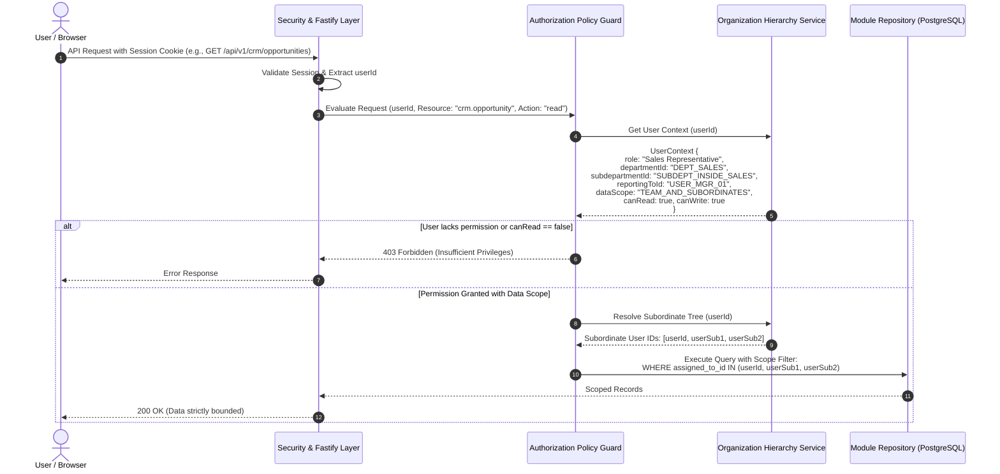
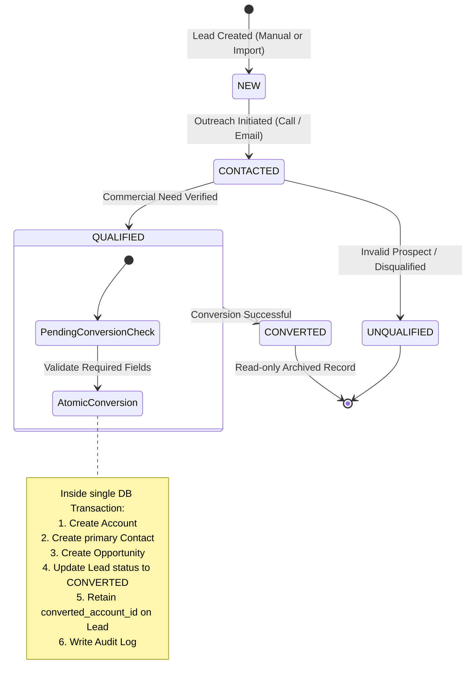
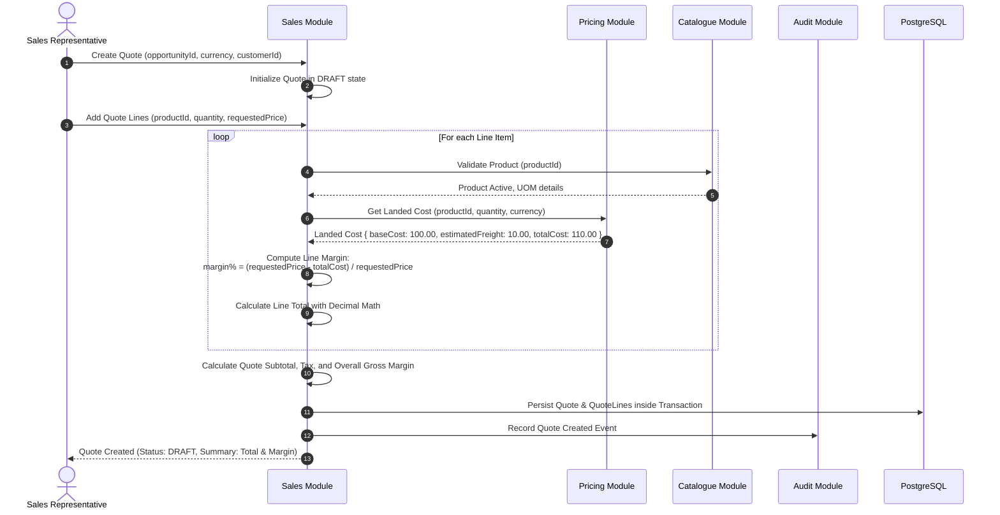
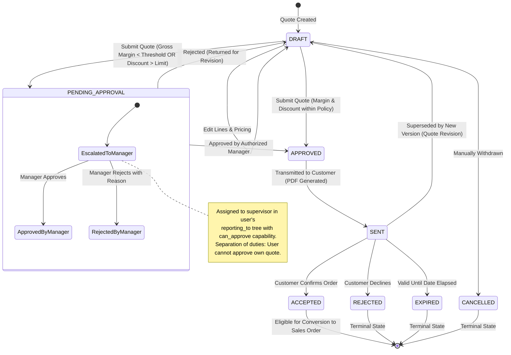
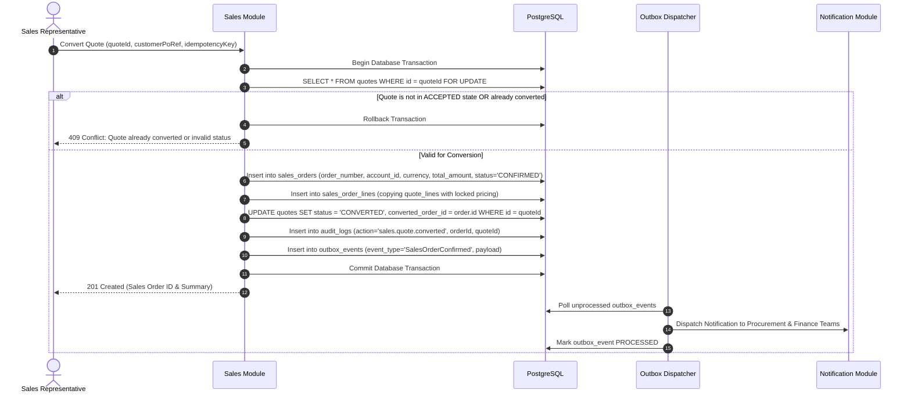
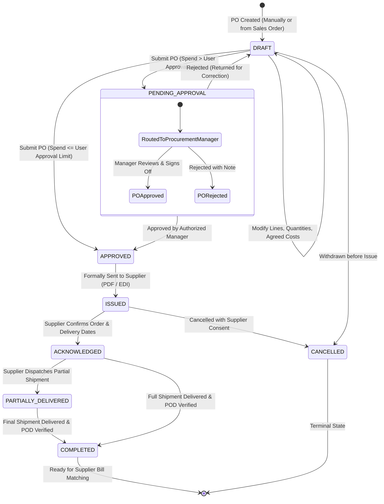
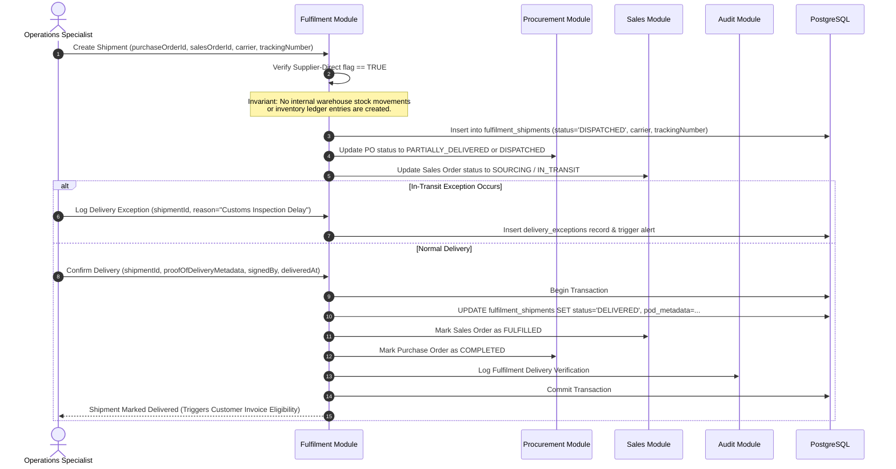
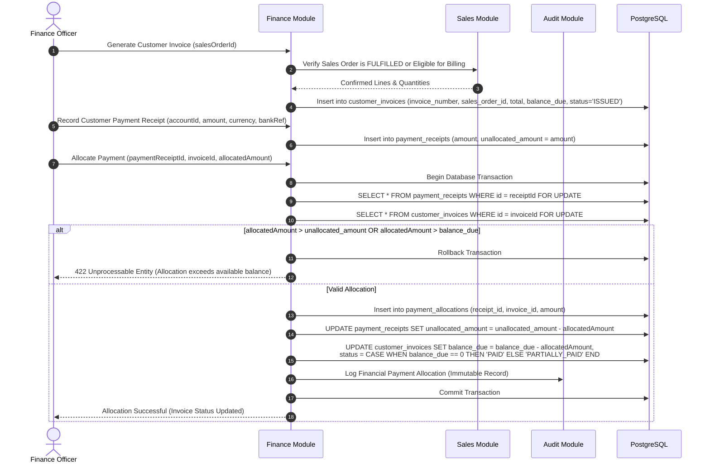

# Domain Glossary and Core Business Workflows

## Status: Approved Architecture Specification (Phase 0)

Last Updated: 2026-10-14

---

## 1. Domain Glossary

This glossary defines ubiquitous language across Polybridge Ventures Trading Management CRM. All code symbols, database entities, UI labels, and documentation must adhere to these terms.

### 1.1 Identity, Organizational Hierarchy & Access Control

| Term                                | Definition                                                                                                                                                              | Invariants & Rules                                                                                                 |
| :---------------------------------- | :---------------------------------------------------------------------------------------------------------------------------------------------------------------------- | :----------------------------------------------------------------------------------------------------------------- |
| **Organization**                    | The top-level legal entity or business unit operating the CRM.                                                                                                          | Root container for all departments, users, and business data.                                                      |
| **Department**                      | A functional division within the organization (e.g., Sales, Procurement, Operations, Finance, Executive, IT).                                                           | Every user belongs to exactly one primary department.                                                              |
| **Subdepartment**                   | A specialized team or sub-unit within a department (e.g., Inside Sales, International Sourcing, Accounts Payable).                                                      | Must belong to a valid parent department.                                                                          |
| **Designation**                     | The official job title or seniority level assigned to an employee (e.g., Junior Trader, Senior Sourcing Lead, Finance Manager, VP Commercial).                          | Determines default approval limits and role assignments.                                                           |
| **User**                            | An authenticated human operator with a unique email, credentials, assigned designation, department, subdepartment, and supervisor.                                      | Must have active status to access APIs. Cannot be self-registered.                                                 |
| **Reporting Line (`reporting_to`)** | The hierarchical supervisor-subordinate relationship where a User points to their direct manager (`reporting_to_id`).                                                   | Forms a directed acyclic graph (DAG). Cyclic reporting relationships are strictly prohibited by domain validation. |
| **Role**                            | A named collection of operational permissions (e.g., `Sales Representative`, `Procurement Specialist`, `Finance Manager`, `System Administrator`).                      | Users can be assigned one or more roles.                                                                           |
| **Permission**                      | A fine-grained authorization capability formatted as `resource.action` (e.g., `sales.quote.read`, `sales.quote.create`, `sales.quote.approve`, `procurement.po.issue`). | Evaluated deny-by-default on every request.                                                                        |
| **Data Scope**                      | The record-level visibility boundary applied to read and write actions: `OWN_ONLY`, `TEAM_AND_SUBORDINATES`, `SUBDEPARTMENT`, `DEPARTMENT`, or `GLOBAL`.                | Applied dynamically to query filters and mutation guards based on user role and hierarchy.                         |
| **Can Read / Can Write**            | Explicit boolean capabilities attached to role-permission mappings defining whether the user has read-only or read-write access within their data scope.                | Prevents unintentional write escalation for auditing or monitoring roles.                                          |

### 1.2 CRM & Relationship Management

| Term            | Definition                                                                                                         | Invariants & Rules                                                                                   |
| :-------------- | :----------------------------------------------------------------------------------------------------------------- | :--------------------------------------------------------------------------------------------------- |
| **Lead**        | An unqualified individual or company prospect showing potential interest in trading transactions.                  | Has statuses `NEW`, `CONTACTED`, `QUALIFIED`, `UNQUALIFIED`, `CONVERTED`. Cannot be converted twice. |
| **Account**     | A verified commercial trading partner (Customer or Client Company).                                                | Master record for contacts, opportunities, quotes, and orders.                                       |
| **Contact**     | An individual person associated with an Account (e.g., Buyer, Procurement Officer, Accounts Payable Clerk).        | Must reference a valid Account.                                                                      |
| **Opportunity** | A qualified commercial sales deal tracked through pipeline stages toward closed-won or closed-lost.                | Has estimated value, target close date, pipeline stage, and probability.                             |
| **Activity**    | A timestamped interaction record (phone call, meeting, email log, follow-up task, or note) linked to a CRM entity. | Immutable once logged, with audit trail of author and timestamps.                                    |

### 1.3 Product Catalogue & Pricing Engine

| Term                      | Definition                                                                                                                  | Invariants & Rules                                                                        |
| :------------------------ | :-------------------------------------------------------------------------------------------------------------------------- | :---------------------------------------------------------------------------------------- |
| **Product**               | A standard trading commodity or item that Polybridge Ventures quotes, sells, or procures.                                   | Has a unique SKU, name, description, unit of measure, and active flag.                    |
| **Category**              | Hierarchical taxonomy grouping products (e.g., Chemicals, Industrial Materials, Consumer Goods).                            | Cannot be deleted if products are associated.                                             |
| **Unit of Measure (UOM)** | Standard physical measurement unit (e.g., MT, KG, Liter, Box, Piece).                                                       | Invariant: All quote lines and PO lines must explicitly declare their UOM.                |
| **Supplier Product**      | The mapping associating a specific Supplier with a Product, including the supplier's external part number and lead time.    | Must link valid Supplier and Product records.                                             |
| **Supplier Offer**        | A quoted price/cost for a product provided by a supplier, with effective validity dates and minimum order quantities (MOQ). | Provides the baseline cost for quote margin calculations.                                 |
| **Landed Cost**           | The total cost of sourcing a product, including base supplier offer price, freight, customs duties, and handling costs.     | Must be computed with decimal precision.                                                  |
| **Gross Margin**          | Commercial margin calculated as: $\frac{\text{Selling Price} - \text{Landed Cost}}{\text{Selling Price}} \times 100\%$.     | If below the company threshold (e.g., $< 15\%$), triggers commercial approval escalation. |

### 1.4 Quotations & Sales Lifecycle

| Term                 | Definition                                                                                                                              | Invariants & Rules                                                                                   |
| :------------------- | :-------------------------------------------------------------------------------------------------------------------------------------- | :--------------------------------------------------------------------------------------------------- |
| **Quote**            | A formal commercial offer presented to a customer specifying items, quantities, prices, currency, terms, and validity.                  | Governed by an explicit state machine. Cannot be edited once approved or sent.                       |
| **Quote Line**       | An individual line item on a Quote referencing a Product, quantity, unit cost, unit selling price, discount, and calculated line total. | Line total and margins revalidated server-side on creation/edit.                                     |
| **Quote Version**    | Revision increment for quotes. When modifications are requested on an issued quote, a new version is created.                           | Retains historical trail. Previous versions are marked `SUPERSEDED`.                                 |
| **Approval Request** | An escalation workflow generated when a Quote or PO breaches margin or discount rules.                                                  | Requires authorization by a manager in the user's `reporting_to` line with `can_approve` capability. |
| **Sales Order**      | A binding commercial order confirmed with the customer, typically converted from an accepted Quote.                                     | Immutable pricing; initiates procurement and fulfilment workflows.                                   |
| **Sales Order Line** | Line item of a confirmed Sales Order specifying confirmed product quantities and delivery schedules.                                    | Linked to subsequent PO lines and fulfilment shipments.                                              |

### 1.5 Procurement & Fulfilment

| Term                         | Definition                                                                                                               | Invariants & Rules                                                                         |
| :--------------------------- | :----------------------------------------------------------------------------------------------------------------------- | :----------------------------------------------------------------------------------------- |
| **Supplier**                 | A vendor or manufacturer from whom Polybridge Ventures procures trading commodities.                                     | Verified commercial profile with payment terms, currency, and tax credentials.             |
| **Purchase Order (PO)**      | A binding commercial contract issued to a Supplier to purchase goods for customer sales orders or trade operations.      | Explicit authorization required before issuance; cannot be edited once issued.             |
| **Purchase Order Line**      | Specific product, quantity, unit cost, and scheduled ship date agreed with the supplier.                                 | Linked to the originating Sales Order line when back-to-back trading applies.              |
| **Supplier-Direct Delivery** | Fulfilment mechanism where the supplier ships products directly to the customer's delivery address (Drop-shipping).      | **Does not create company warehouse inventory receipts or internal stock ledger entries.** |
| **Fulfilment Shipment**      | A tracked physical movement of goods from supplier to customer or warehouse.                                             | Records carrier name, tracking number, dispatch date, and delivery status.                 |
| **Proof of Delivery (POD)**  | Formal verification (signed consignment note, delivery receipt metadata, or electronic stamp) confirming client receipt. | Mandatory milestone before transitioning Fulfilment to `DELIVERED`.                        |
| **Delivery Exception**       | An incident report logged during transit (damage, delay, customs hold, discrepancy).                                     | Triggers notification to operations and account manager.                                   |

### 1.6 Finance & Financial Tracking

| Term                   | Definition                                                                                        | Invariants & Rules                                                                                     |
| :--------------------- | :------------------------------------------------------------------------------------------------ | :----------------------------------------------------------------------------------------------------- |
| **Customer Invoice**   | A receivable billing document issued to a customer based on fulfilled or confirmed Sales Orders.  | Strictly sequential numbering; immutable once issued; corrections require Credit Notes or Void status. |
| **Payment Receipt**    | Record of funds received from a customer into Polybridge bank accounts.                           | Records bank reference, payment method, amount, currency, and unallocated balance.                     |
| **Payment Allocation** | Association linking a Payment Receipt to one or more Customer Invoices.                           | Total allocations cannot exceed total receipt amount. Invoices update to `PAID` or `PARTIALLY_PAID`.   |
| **Supplier Bill**      | An accounts payable liability document received from a supplier against an issued Purchase Order. | Matched against PO line prices and received quantities.                                                |
| **Supplier Payment**   | Disbursement record confirming payment to a supplier against one or more approved Supplier Bills. | Records payment authorization, wire/bank reference, and payment date.                                  |

---

## 2. Core Business Workflows

### 2.1 Workflow 1: User Organization Hierarchy & Data Scoping Resolution

Every authenticated API request resolves the user's identity, designation, department, subdepartment, and `reporting_to` manager tree to compute active data boundaries.

---

### 2.2 Workflow 2: Lead Qualification and Conversion Flow

---

### 2.3 Workflow 3: Opportunity to Quote Creation & Pricing/Margin Calculation

---

### 2.4 Workflow 4: Quotation Lifecycle & Approval State Machine

---

### 2.5 Workflow 5: Atomic Quote-to-Sales Order Conversion

---

### 2.6 Workflow 6: Procurement & Purchase Order Lifecycle

---

### 2.7 Workflow 7: Supplier-Direct Fulfilment (Drop-shipping)

---

### 2.8 Workflow 8: Finance Billing, Payment Matching & Invariant Enforcement

