# Entity-Relationship Architecture and Data Model

## Status: Approved Architecture Specification (Phase 0)

Last Updated: 2026-10-14

---

## 1. Data Modeling Invariants and Engineering Standards

1. **Identifier Strategy:**
   - All primary keys use `UUID` (PostgreSQL `uuid` type with UUIDv7 generation for chronological clustering and indexing efficiency).
   - Public reference numbers (e.g., `quote_number`, `order_number`, `po_number`, `invoice_number`) use sequential alphanumeric identifiers generated by PostgreSQL sequences (e.g., `Q-2026-00001`, `INV-2026-00001`).
   - Identifiers are never used as authorization controls.

2. **Monetary Values and Precision:**
   - Financial amounts (prices, costs, discounts, tax, margins, payment allocations) are strictly modeled using PostgreSQL `NUMERIC(14, 4)` (or `NUMERIC(12, 2)` for final displayed ledger amounts).
   - **Floating point types (`FLOAT`, `DOUBLE PRECISION`, `REAL`) are strictly prohibited.**
   - All monetary amounts require an explicit 3-letter ISO-4217 currency code (e.g., `USD`, `EUR`, `GBP`).

3. **Time and Timezones:**
   - All timestamps use `TIMESTAMPTZ` (timestamp with time zone) and are stored in Coordinated Universal Time (UTC). UI components localize display time.

4. **Audit and Soft Deletes:**
   - Core commercial and financial entities (quotes, orders, purchase orders, invoices, payments, audit logs) **must never be physically deleted** once issued or converted.
   - Soft deletion (`deleted_at TIMESTAMPTZ NULL`) is permitted only on preliminary scratch records (e.g., unassigned leads, draft notes) with strict audit tracking.

---

## 2. Global Entity-Relationship Diagram

```mermaid
erDiagram
    %% ==========================================
    %% IDENTITY, ORG HIERARCHY & ROLE SCOPING
    %% ==========================================
    ORGANIZATIONS ||--o{ DEPARTMENTS : contains
    ORGANIZATIONS ||--o{ USERS : owns
    DEPARTMENTS ||--o{ SUBDEPARTMENTS : contains
    DEPARTMENTS ||--o{ DESIGNATIONS : defines
    DEPARTMENTS ||--o{ USERS : assigns
    SUBDEPARTMENTS ||--o{ USERS : assigns
    DESIGNATIONS ||--o{ USERS : classifies
    USERS ||--o{ USERS : "reporting_to (manager hierarchy)"
    USERS ||--o{ USER_ROLES : assigned
    ROLES ||--o{ USER_ROLES : grants
    ROLES ||--o{ ROLE_PERMISSIONS : defines
    PERMISSIONS ||--o{ ROLE_PERMISSIONS : maps
    USERS ||--o{ USER_SESSIONS : maintains

    %% ==========================================
    %% CRM
    %% ==========================================
    ORGANIZATIONS ||--o{ LEADS : owns
    USERS ||--o{ LEADS : assigned_to
    ORGANIZATIONS ||--o{ ACCOUNTS : owns
    USERS ||--o{ ACCOUNTS : manages
    ACCOUNTS ||--o{ CONTACTS : employs
    ACCOUNTS ||--o{ OPPORTUNITIES : generates
    USERS ||--o{ OPPORTUNITIES : owns
    OPPORTUNITIES ||--o{ ACTIVITIES : tracks

    %% ==========================================
    %% CATALOGUE & PRICING
    %% ==========================================
    CATEGORIES ||--o{ PRODUCTS : categorizes
    UNITS_OF_MEASURE ||--o{ PRODUCTS : measures
    PRODUCTS ||--o{ SUPPLIER_PRODUCTS : mapped_to
    SUPPLIERS ||--o{ SUPPLIER_PRODUCTS : supplies
    SUPPLIER_PRODUCTS ||--o{ SUPPLIER_OFFERS : quotes

    %% ==========================================
    %% QUOTATIONS & SALES
    %% ==========================================
    ACCOUNTS ||--o{ QUOTES : receives
    OPPORTUNITIES ||--o{ QUOTES : originates
    USERS ||--o{ QUOTES : creates
    QUOTES ||--o{ QUOTE_LINES : includes
    PRODUCTS ||--o{ QUOTE_LINES : references
    QUOTES ||--o{ QUOTE_APPROVAL_REQUESTS : requires
    USERS ||--o{ QUOTE_APPROVAL_REQUESTS : approves
    QUOTES ||--o{ SALES_ORDERS : converts_to
    ACCOUNTS ||--o{ SALES_ORDERS : places
    SALES_ORDERS ||--o{ SALES_ORDER_LINES : contains
    PRODUCTS ||--o{ SALES_ORDER_LINES : references

    %% ==========================================
    %% PROCUREMENT
    %% ==========================================
    ORGANIZATIONS ||--o{ SUPPLIERS : registers
    SUPPLIERS ||--o{ SUPPLIER_CONTACTS : employs
    SUPPLIERS ||--o{ PURCHASE_ORDERS : receives
    USERS ||--o{ PURCHASE_ORDERS : creates
    SALES_ORDER_LINES ||--o{ PURCHASE_ORDER_LINES : fulfills_back_to_back
    PURCHASE_ORDERS ||--o{ PURCHASE_ORDER_LINES : contains
    PRODUCTS ||--o{ PURCHASE_ORDER_LINES : purchases

    %% ==========================================
    %% FULFILMENT (SUPPLIER-DIRECT)
    %% ==========================================
    PURCHASE_ORDERS ||--o{ FULFILMENT_SHIPMENTS : tracks
    SALES_ORDERS ||--o{ FULFILMENT_SHIPMENTS : delivers_for
    FULFILMENT_SHIPMENTS ||--o{ SHIPMENT_LINES : contains
    FULFILMENT_SHIPMENTS ||--o{ DELIVERY_EXCEPTIONS : logs

    %% ==========================================
    %% FINANCE
    %% ==========================================
    SALES_ORDERS ||--o{ CUSTOMER_INVOICES : bills
    CUSTOMER_INVOICES ||--o{ INVOICE_LINES : contains
    ACCOUNTS ||--o{ PAYMENT_RECEIPTS : receives_from
    PAYMENT_RECEIPTS ||--o{ PAYMENT_ALLOCATIONS : allocates
    CUSTOMER_INVOICES ||--o{ PAYMENT_ALLOCATIONS : clears
    PURCHASE_ORDERS ||--o{ SUPPLIER_BILLS : charges
    SUPPLIER_BILLS ||--o{ BILL_LINES : contains
    SUPPLIERS ||--o{ SUPPLIER_PAYMENTS : paid_to
    SUPPLIER_BILLS ||--o{ SUPPLIER_PAYMENTS : settles

    %% ==========================================
    %% AUDIT
    %% ==========================================
    USERS ||--o{ AUDIT_LOGS : performs
```

---

## 3. Detailed Entity Schemas by Module

### 3.1 Module: `organizations` and `identity-access`

#### `organizations`

| Field           | Type         | Modifiers                      | Description                           |
| :-------------- | :----------- | :----------------------------- | :------------------------------------ |
| `id`            | UUID         | PK, DEFAULT uuid_generate_v7() | Unique organization identifier        |
| `name`          | VARCHAR(120) | NOT NULL, UNIQUE               | Registered company / operating name   |
| `code`          | VARCHAR(20)  | NOT NULL, UNIQUE               | Short code (e.g., `PBV-GLOBAL`)       |
| `base_currency` | VARCHAR(3)   | NOT NULL, DEFAULT 'USD'        | Default reporting currency (ISO 4217) |
| `is_active`     | BOOLEAN      | NOT NULL, DEFAULT TRUE         | Status flag                           |
| `created_at`    | TIMESTAMPTZ  | NOT NULL, DEFAULT NOW()        | Timestamp in UTC                      |
| `updated_at`    | TIMESTAMPTZ  | NOT NULL, DEFAULT NOW()        | Timestamp in UTC                      |

#### `departments`

| Field             | Type        | Modifiers                         | Description                             |
| :---------------- | :---------- | :-------------------------------- | :-------------------------------------- |
| `id`              | UUID        | PK                                | Department identifier                   |
| `organization_id` | UUID        | FK -> organizations(id), NOT NULL | Owning organization                     |
| `name`            | VARCHAR(80) | NOT NULL                          | e.g., 'Sales', 'Procurement', 'Finance' |
| `code`            | VARCHAR(20) | NOT NULL                          | Unique department code                  |
| `created_at`      | TIMESTAMPTZ | NOT NULL, DEFAULT NOW()           | Record creation time                    |

#### `subdepartments`

| Field           | Type        | Modifiers                       | Description                             |
| :-------------- | :---------- | :------------------------------ | :-------------------------------------- |
| `id`            | UUID        | PK                              | Subdepartment identifier                |
| `department_id` | UUID        | FK -> departments(id), NOT NULL | Parent department                       |
| `name`          | VARCHAR(80) | NOT NULL                        | e.g., 'Inside Sales', 'Direct Sourcing' |
| `code`          | VARCHAR(20) | NOT NULL                        | Subdepartment code                      |
| `created_at`    | TIMESTAMPTZ | NOT NULL, DEFAULT NOW()         | Record creation time                    |

#### `designations`

| Field                    | Type          | Modifiers                       | Description                                  |
| :----------------------- | :------------ | :------------------------------ | :------------------------------------------- |
| `id`                     | UUID          | PK                              | Designation identifier                       |
| `department_id`          | UUID          | FK -> departments(id), NOT NULL | Department classification                    |
| `title`                  | VARCHAR(80)   | NOT NULL                        | e.g., 'Junior Trader', 'Finance Director'    |
| `seniority_level`        | INTEGER       | NOT NULL, DEFAULT 1             | Hierarchy ranking (1 = entry, 5 = executive) |
| `default_approval_limit` | NUMERIC(14,4) | NULL                            | Default max PO spend or discount limit       |

#### `users`

| Field              | Type         | Modifiers                         | Description                         |
| :----------------- | :----------- | :-------------------------------- | :---------------------------------- |
| `id`               | UUID         | PK                                | Unique user identifier              |
| `organization_id`  | UUID         | FK -> organizations(id), NOT NULL | Tenant boundary                     |
| `department_id`    | UUID         | FK -> departments(id), NOT NULL   | Primary department                  |
| `subdepartment_id` | UUID         | FK -> subdepartments(id), NULL    | Sub-team / desk                     |
| `designation_id`   | UUID         | FK -> designations(id), NOT NULL  | Employee designation                |
| `reporting_to_id`  | UUID         | FK -> users(id), NULL             | Direct manager in supervisor tree   |
| `email`            | VARCHAR(255) | NOT NULL, UNIQUE                  | Login email (lowercase, normalized) |
| `password_hash`    | VARCHAR(255) | NOT NULL                          | Argon2id password hash              |
| `first_name`       | VARCHAR(80)  | NOT NULL                          | Given name                          |
| `last_name`        | VARCHAR(80)  | NOT NULL                          | Surname                             |
| `phone_number`     | VARCHAR(40)  | NULL                              | Work contact number                 |
| `is_active`        | BOOLEAN      | NOT NULL, DEFAULT TRUE            | Account state                       |
| `is_mfa_enabled`   | BOOLEAN      | NOT NULL, DEFAULT FALSE           | MFA enforcement flag                |
| `mfa_secret`       | VARCHAR(255) | NULL                              | Encrypted TOTP secret               |
| `last_login_at`    | TIMESTAMPTZ  | NULL                              | Timestamp of last successful auth   |
| `created_at`       | TIMESTAMPTZ  | NOT NULL, DEFAULT NOW()           | Creation timestamp                  |
| `updated_at`       | TIMESTAMPTZ  | NOT NULL, DEFAULT NOW()           | Update timestamp                    |

_Constraints:_ Check constraint ensuring `reporting_to_id != id` (cannot report to self). Domain service enforces acyclic tree.

#### `roles`

| Field         | Type         | Modifiers               | Description                      |
| :------------ | :----------- | :---------------------- | :------------------------------- |
| `id`          | UUID         | PK                      | Role identifier                  |
| `name`        | VARCHAR(60)  | NOT NULL, UNIQUE        | Role name (e.g., 'Sales Trader') |
| `description` | VARCHAR(255) | NULL                    | Role description                 |
| `is_system`   | BOOLEAN      | NOT NULL, DEFAULT FALSE | Prevents deletion of core roles  |

#### `permissions`

| Field         | Type         | Modifiers | Description                                 |
| :------------ | :----------- | :-------- | :------------------------------------------ |
| `id`          | UUID         | PK        | Permission identifier                       |
| `resource`    | VARCHAR(50)  | NOT NULL  | e.g., 'sales.quote', 'procurement.po'       |
| `action`      | VARCHAR(50)  | NOT NULL  | e.g., 'read', 'create', 'approve', 'export' |
| `description` | VARCHAR(255) | NULL      | Human readable explanation                  |

_Index:_ Unique composite index on `(resource, action)`.

#### `role_permissions`

| Field           | Type        | Modifiers                    | Description                                                                         |
| :-------------- | :---------- | :--------------------------- | :---------------------------------------------------------------------------------- |
| `role_id`       | UUID        | FK -> roles(id), PK          | Associated role                                                                     |
| `permission_id` | UUID        | FK -> permissions(id), PK    | Associated permission                                                               |
| `can_read`      | BOOLEAN     | NOT NULL, DEFAULT TRUE       | Read permission flag                                                                |
| `can_write`     | BOOLEAN     | NOT NULL, DEFAULT FALSE      | Create / update permission flag                                                     |
| `can_approve`   | BOOLEAN     | NOT NULL, DEFAULT FALSE      | Authority to approve transactions                                                   |
| `can_delete`    | BOOLEAN     | NOT NULL, DEFAULT FALSE      | Authority to soft-delete / withdraw                                                 |
| `data_scope`    | VARCHAR(30) | NOT NULL, DEFAULT 'OWN_ONLY' | Scope: `OWN_ONLY`, `TEAM_AND_SUBORDINATES`, `SUBDEPARTMENT`, `DEPARTMENT`, `GLOBAL` |

#### `user_roles`

| Field         | Type        | Modifiers               | Description          |
| :------------ | :---------- | :---------------------- | :------------------- |
| `user_id`     | UUID        | FK -> users(id), PK     | Target user          |
| `role_id`     | UUID        | FK -> roles(id), PK     | Assigned role        |
| `assigned_at` | TIMESTAMPTZ | NOT NULL, DEFAULT NOW() | Assignment timestamp |

#### `user_sessions`

| Field                | Type         | Modifiers                         | Description                           |
| :------------------- | :----------- | :-------------------------------- | :------------------------------------ |
| `id`                 | UUID         | PK                                | Session identifier                    |
| `user_id`            | UUID         | FK -> users(id) ON DELETE CASCADE | Associated user                       |
| `session_token_hash` | VARCHAR(255) | NOT NULL, UNIQUE                  | SHA-256 hash of session cookie token  |
| `ip_address`         | VARCHAR(45)  | NOT NULL                          | Client IP                             |
| `user_agent`         | VARCHAR(255) | NOT NULL                          | Client browser string                 |
| `expires_at`         | TIMESTAMPTZ  | NOT NULL                          | Session expiry time                   |
| `revoked_at`         | TIMESTAMPTZ  | NULL                              | Manual logout or revocation timestamp |
| `created_at`         | TIMESTAMPTZ  | NOT NULL, DEFAULT NOW()           | Session inception                     |

---

### 3.2 Module: `crm`

#### `leads`

| Field                  | Type         | Modifiers                         | Description                                                 |
| :--------------------- | :----------- | :-------------------------------- | :---------------------------------------------------------- |
| `id`                   | UUID         | PK                                | Unique lead identifier                                      |
| `organization_id`      | UUID         | FK -> organizations(id), NOT NULL | Owning organization                                         |
| `first_name`           | VARCHAR(80)  | NOT NULL                          | Prospect first name                                         |
| `last_name`            | VARCHAR(80)  | NOT NULL                          | Prospect last name                                          |
| `company_name`         | VARCHAR(120) | NOT NULL                          | Prospect company name                                       |
| `email`                | VARCHAR(255) | NOT NULL                          | Email address                                               |
| `phone`                | VARCHAR(40)  | NULL                              | Phone number                                                |
| `lead_source`          | VARCHAR(60)  | NOT NULL                          | e.g., 'Website', 'Referral', 'Trade Show'                   |
| `status`               | VARCHAR(30)  | NOT NULL, DEFAULT 'NEW'           | `NEW`, `CONTACTED`, `QUALIFIED`, `UNQUALIFIED`, `CONVERTED` |
| `assigned_to_id`       | UUID         | FK -> users(id), NULL             | Assigned sales representative                               |
| `converted_account_id` | UUID         | FK -> accounts(id), NULL          | Converted Account reference                                 |
| `created_at`           | TIMESTAMPTZ  | NOT NULL, DEFAULT NOW()           | Timestamp                                                   |
| `updated_at`           | TIMESTAMPTZ  | NOT NULL, DEFAULT NOW()           | Timestamp                                                   |

#### `accounts`

| Field                | Type         | Modifiers                         | Description                              |
| :------------------- | :----------- | :-------------------------------- | :--------------------------------------- |
| `id`                 | UUID         | PK                                | Unique account identifier                |
| `organization_id`    | UUID         | FK -> organizations(id), NOT NULL | Owning organization                      |
| `account_number`     | VARCHAR(30)  | NOT NULL, UNIQUE                  | Unique customer code (e.g., `ACC-00102`) |
| `name`               | VARCHAR(120) | NOT NULL                          | Trading customer company name            |
| `tax_identifier`     | VARCHAR(50)  | NULL                              | VAT / Tax ID / EIN                       |
| `billing_address`    | JSONB        | NOT NULL                          | Structured address object                |
| `shipping_address`   | JSONB        | NOT NULL                          | Default delivery address                 |
| `payment_terms_days` | INTEGER      | NOT NULL, DEFAULT 30              | Agreed payment credit terms              |
| `assigned_to_id`     | UUID         | FK -> users(id), NOT NULL         | Account manager / owner                  |
| `is_active`          | BOOLEAN      | NOT NULL, DEFAULT TRUE            | Active trading status                    |
| `created_at`         | TIMESTAMPTZ  | NOT NULL, DEFAULT NOW()           | Timestamp                                |
| `updated_at`         | TIMESTAMPTZ  | NOT NULL, DEFAULT NOW()           | Timestamp                                |

#### `contacts`

| Field             | Type         | Modifiers                    | Description                 |
| :---------------- | :----------- | :--------------------------- | :-------------------------- |
| `id`              | UUID         | PK                           | Unique contact identifier   |
| `account_id`      | UUID         | FK -> accounts(id), NOT NULL | Parent customer account     |
| `first_name`      | VARCHAR(80)  | NOT NULL                     | First name                  |
| `last_name`       | VARCHAR(80)  | NOT NULL                     | Last name                   |
| `email`           | VARCHAR(255) | NOT NULL                     | Email address               |
| `phone`           | VARCHAR(40)  | NULL                         | Phone number                |
| `role_in_company` | VARCHAR(80)  | NULL                         | e.g., 'Head of Procurement' |
| `is_primary`      | BOOLEAN      | NOT NULL, DEFAULT FALSE      | Primary contact indicator   |
| `created_at`      | TIMESTAMPTZ  | NOT NULL, DEFAULT NOW()      | Timestamp                   |

#### `opportunities`

| Field               | Type          | Modifiers                    | Description                                                           |
| :------------------ | :------------ | :--------------------------- | :-------------------------------------------------------------------- |
| `id`                | UUID          | PK                           | Opportunity identifier                                                |
| `account_id`        | UUID          | FK -> accounts(id), NOT NULL | Target customer account                                               |
| `name`              | VARCHAR(120)  | NOT NULL                     | Deal title (e.g., 'Q3 Resin Supply')                                  |
| `stage`             | VARCHAR(40)   | NOT NULL                     | `PROSPECTING`, `PROPOSAL`, `NEGOTIATION`, `CLOSED_WON`, `CLOSED_LOST` |
| `currency`          | VARCHAR(3)    | NOT NULL, DEFAULT 'USD'      | Deal currency                                                         |
| `estimated_value`   | NUMERIC(14,4) | NOT NULL                     | Deal revenue forecast                                                 |
| `target_close_date` | DATE          | NOT NULL                     | Target closing date                                                   |
| `probability`       | INTEGER       | NOT NULL, DEFAULT 50         | Probability percentage (0-100)                                        |
| `assigned_to_id`    | UUID          | FK -> users(id), NOT NULL    | Deal owner                                                            |
| `created_at`        | TIMESTAMPTZ   | NOT NULL, DEFAULT NOW()      | Timestamp                                                             |
| `updated_at`        | TIMESTAMPTZ   | NOT NULL, DEFAULT NOW()      | Timestamp                                                             |

#### `activities`

| Field             | Type         | Modifiers                         | Description                               |
| :---------------- | :----------- | :-------------------------------- | :---------------------------------------- |
| `id`              | UUID         | PK                                | Activity identifier                       |
| `organization_id` | UUID         | FK -> organizations(id), NOT NULL | Tenant scoping                            |
| `entity_type`     | VARCHAR(40)  | NOT NULL                          | 'lead', 'account', 'opportunity', 'quote' |
| `entity_id`       | UUID         | NOT NULL                          | Target entity identifier                  |
| `activity_type`   | VARCHAR(40)  | NOT NULL                          | 'call', 'meeting', 'task', 'note'         |
| `subject`         | VARCHAR(160) | NOT NULL                          | Summary line                              |
| `description`     | TEXT         | NULL                              | Detailed notes                            |
| `due_date`        | TIMESTAMPTZ  | NULL                              | Due date for follow-up tasks              |
| `is_completed`    | BOOLEAN      | NOT NULL, DEFAULT FALSE           | Completion status                         |
| `created_by_id`   | UUID         | FK -> users(id), NOT NULL         | Activity author                           |
| `created_at`      | TIMESTAMPTZ  | NOT NULL, DEFAULT NOW()           | Creation timestamp                        |

---

### 3.3 Module: `catalogue` and `pricing`

#### `categories`

| Field       | Type        | Modifiers                  | Description                      |
| :---------- | :---------- | :------------------------- | :------------------------------- |
| `id`        | UUID        | PK                         | Category identifier              |
| `name`      | VARCHAR(80) | NOT NULL, UNIQUE           | Category name                    |
| `parent_id` | UUID        | FK -> categories(id), NULL | Self-referencing parent category |

#### `units_of_measure`

| Field  | Type        | Modifiers        | Description                             |
| :----- | :---------- | :--------------- | :-------------------------------------- |
| `id`   | UUID        | PK               | UOM identifier                          |
| `code` | VARCHAR(10) | NOT NULL, UNIQUE | Standard code: 'KG', 'MT', 'LTR', 'PCS' |
| `name` | VARCHAR(60) | NOT NULL         | Full name: 'Metric Ton', 'Kilogram'     |

#### `products`

| Field             | Type         | Modifiers                            | Description             |
| :---------------- | :----------- | :----------------------------------- | :---------------------- |
| `id`              | UUID         | PK                                   | Product identifier      |
| `organization_id` | UUID         | FK -> organizations(id), NOT NULL    | Tenant scoping          |
| `sku`             | VARCHAR(60)  | NOT NULL, UNIQUE                     | Stock keeping unit      |
| `name`            | VARCHAR(120) | NOT NULL                             | Product commercial name |
| `description`     | TEXT         | NULL                                 | Technical specification |
| `category_id`     | UUID         | FK -> categories(id), NOT NULL       | Associated category     |
| `uom_id`          | UUID         | FK -> units_of_measure(id), NOT NULL | Base unit of measure    |
| `is_active`       | BOOLEAN      | NOT NULL, DEFAULT TRUE               | Active in catalogue     |
| `created_at`      | TIMESTAMPTZ  | NOT NULL, DEFAULT NOW()              | Creation timestamp      |

#### `supplier_products`

| Field                     | Type        | Modifiers                     | Description                |
| :------------------------ | :---------- | :---------------------------- | :------------------------- |
| `id`                      | UUID        | PK                            | Mapping identifier         |
| `supplier_id`             | UUID        | FK -> suppliers(id), NOT NULL | Sourcing supplier          |
| `product_id`              | UUID        | FK -> products(id), NOT NULL  | Mapped product             |
| `supplier_part_number`    | VARCHAR(80) | NULL                          | Supplier catalog reference |
| `standard_lead_time_days` | INTEGER     | NOT NULL, DEFAULT 14          | Quoted supplier lead time  |

_Constraint:_ Unique composite constraint on `(supplier_id, product_id)`.

#### `supplier_offers`

| Field                 | Type          | Modifiers                             | Description                  |
| :-------------------- | :------------ | :------------------------------------ | :--------------------------- |
| `id`                  | UUID          | PK                                    | Offer identifier             |
| `supplier_product_id` | UUID          | FK -> supplier_products(id), NOT NULL | Sourcing product mapping     |
| `currency`            | VARCHAR(3)    | NOT NULL                              | Offer currency (e.g., 'USD') |
| `unit_cost`           | NUMERIC(14,4) | NOT NULL                              | Quoted unit purchase cost    |
| `moq`                 | NUMERIC(14,4) | NOT NULL, DEFAULT 1                   | Minimum order quantity       |
| `valid_from`          | TIMESTAMPTZ   | NOT NULL                              | Offer validity start         |
| `valid_until`         | TIMESTAMPTZ   | NOT NULL                              | Offer expiration date        |
| `is_active`           | BOOLEAN       | NOT NULL, DEFAULT TRUE                | Active flag                  |

---

### 3.4 Module: `sales` (Quotations & Sales Orders)

#### `quotes`

| Field                  | Type          | Modifiers                         | Description                                                                                                  |
| :--------------------- | :------------ | :-------------------------------- | :----------------------------------------------------------------------------------------------------------- |
| `id`                   | UUID          | PK                                | Quote identifier                                                                                             |
| `organization_id`      | UUID          | FK -> organizations(id), NOT NULL | Tenant scoping                                                                                               |
| `quote_number`         | VARCHAR(30)   | NOT NULL                          | Sequence code (e.g., `Q-2026-00042`)                                                                         |
| `version`              | INTEGER       | NOT NULL, DEFAULT 1               | Quote revision number                                                                                        |
| `account_id`           | UUID          | FK -> accounts(id), NOT NULL      | Customer account                                                                                             |
| `opportunity_id`       | UUID          | FK -> opportunities(id), NULL     | Originating opportunity                                                                                      |
| `status`               | VARCHAR(30)   | NOT NULL, DEFAULT 'DRAFT'         | `DRAFT`, `PENDING_APPROVAL`, `APPROVED`, `SENT`, `ACCEPTED`, `REJECTED`, `EXPIRED`, `CANCELLED`, `CONVERTED` |
| `currency`             | VARCHAR(3)    | NOT NULL                          | Quotation currency                                                                                           |
| `subtotal_amount`      | NUMERIC(14,4) | NOT NULL                          | Total selling price before tax/discounts                                                                     |
| `discount_amount`      | NUMERIC(14,4) | NOT NULL, DEFAULT 0               | Total discount applied                                                                                       |
| `tax_amount`           | NUMERIC(14,4) | NOT NULL, DEFAULT 0               | Total tax applied                                                                                            |
| `total_amount`         | NUMERIC(14,4) | NOT NULL                          | Final quoted amount                                                                                          |
| `total_cost`           | NUMERIC(14,4) | NOT NULL                          | Total landed cost                                                                                            |
| `gross_margin_percent` | NUMERIC(6,2)  | NOT NULL                          | Calculated gross margin percentage                                                                           |
| `valid_until`          | TIMESTAMPTZ   | NOT NULL                          | Expiry date                                                                                                  |
| `created_by_id`        | UUID          | FK -> users(id), NOT NULL         | Author / Sales Rep                                                                                           |
| `approved_by_id`       | UUID          | FK -> users(id), NULL             | Manager who approved discount/margin                                                                         |
| `converted_order_id`   | UUID          | FK -> sales_orders(id), NULL      | Resulting Sales Order reference                                                                              |
| `created_at`           | TIMESTAMPTZ   | NOT NULL, DEFAULT NOW()           | Timestamp                                                                                                    |
| `updated_at`           | TIMESTAMPTZ   | NOT NULL, DEFAULT NOW()           | Timestamp                                                                                                    |

_Constraint:_ Unique composite index on `(quote_number, version)`.

#### `quote_lines`

| Field                 | Type          | Modifiers                                    | Description                   |
| :-------------------- | :------------ | :------------------------------------------- | :---------------------------- |
| `id`                  | UUID          | PK                                           | Quote line identifier         |
| `quote_id`            | UUID          | FK -> quotes(id) ON DELETE CASCADE, NOT NULL | Parent quote                  |
| `product_id`          | UUID          | FK -> products(id), NOT NULL                 | Quoted item                   |
| `uom_id`              | UUID          | FK -> units_of_measure(id), NOT NULL         | Quoted unit of measure        |
| `quantity`            | NUMERIC(14,4) | NOT NULL                                     | Quoted volume                 |
| `unit_cost`           | NUMERIC(14,4) | NOT NULL                                     | Baseline cost per unit        |
| `unit_price`          | NUMERIC(14,4) | NOT NULL                                     | Quoted selling price per unit |
| `discount_percent`    | NUMERIC(6,2)  | NOT NULL, DEFAULT 0                          | Applied line discount         |
| `line_total`          | NUMERIC(14,4) | NOT NULL                                     | Server-calculated total       |
| `line_margin_percent` | NUMERIC(6,2)  | NOT NULL                                     | Server-calculated line margin |

#### `quote_approval_requests`

| Field             | Type         | Modifiers                   | Description                                       |
| :---------------- | :----------- | :-------------------------- | :------------------------------------------------ |
| `id`              | UUID         | PK                          | Approval request identifier                       |
| `quote_id`        | UUID         | FK -> quotes(id), NOT NULL  | Quoted transaction                                |
| `requested_by_id` | UUID         | FK -> users(id), NOT NULL   | Submitting sales rep                              |
| `assigned_to_id`  | UUID         | FK -> users(id), NOT NULL   | Authorized manager in reporting line              |
| `trigger_reason`  | VARCHAR(160) | NOT NULL                    | e.g., 'Gross margin 11.2% is below 15% threshold' |
| `status`          | VARCHAR(30)  | NOT NULL, DEFAULT 'PENDING' | `PENDING`, `APPROVED`, `REJECTED`                 |
| `review_notes`    | TEXT         | NULL                        | Manager justification / instructions              |
| `reviewed_at`     | TIMESTAMPTZ  | NULL                        | Decision timestamp                                |

#### `sales_orders`

| Field                   | Type          | Modifiers                         | Description                                                                       |
| :---------------------- | :------------ | :-------------------------------- | :-------------------------------------------------------------------------------- |
| `id`                    | UUID          | PK                                | Order identifier                                                                  |
| `organization_id`       | UUID          | FK -> organizations(id), NOT NULL | Tenant scoping                                                                    |
| `order_number`          | VARCHAR(30)   | NOT NULL, UNIQUE                  | Reference (e.g., `SO-2026-00015`)                                                 |
| `account_id`            | UUID          | FK -> accounts(id), NOT NULL      | Customer account                                                                  |
| `originating_quote_id`  | UUID          | FK -> quotes(id), NULL            | Source quote reference                                                            |
| `customer_po_reference` | VARCHAR(80)   | NULL                              | Customer's external PO number                                                     |
| `status`                | VARCHAR(30)   | NOT NULL, DEFAULT 'CONFIRMED'     | `DRAFT`, `CONFIRMED`, `SOURCING`, `PARTIALLY_FULFILLED`, `FULFILLED`, `CANCELLED` |
| `currency`              | VARCHAR(3)    | NOT NULL                          | Order currency                                                                    |
| `subtotal_amount`       | NUMERIC(14,4) | NOT NULL                          | Subtotal                                                                          |
| `tax_amount`            | NUMERIC(14,4) | NOT NULL, DEFAULT 0               | Tax amount                                                                        |
| `total_amount`          | NUMERIC(14,4) | NOT NULL                          | Final confirmed total                                                             |
| `shipping_address`      | JSONB         | NOT NULL                          | Delivery destination                                                              |
| `created_by_id`         | UUID          | FK -> users(id), NOT NULL         | Order creator                                                                     |
| `created_at`            | TIMESTAMPTZ   | NOT NULL, DEFAULT NOW()           | Timestamp                                                                         |
| `updated_at`            | TIMESTAMPTZ   | NOT NULL, DEFAULT NOW()           | Timestamp                                                                         |

#### `sales_order_lines`

| Field                | Type          | Modifiers                                          | Description                 |
| :------------------- | :------------ | :------------------------------------------------- | :-------------------------- |
| `id`                 | UUID          | PK                                                 | Line identifier             |
| `sales_order_id`     | UUID          | FK -> sales_orders(id) ON DELETE CASCADE, NOT NULL | Parent order                |
| `product_id`         | UUID          | FK -> products(id), NOT NULL                       | Item                        |
| `uom_id`             | UUID          | FK -> units_of_measure(id), NOT NULL               | Measurement unit            |
| `quantity`           | NUMERIC(14,4) | NOT NULL                                           | Confirmed quantity          |
| `unit_price`         | NUMERIC(14,4) | NOT NULL                                           | Confirmed locked unit price |
| `line_total`         | NUMERIC(14,4) | NOT NULL                                           | Confirmed line total        |
| `fulfilled_quantity` | NUMERIC(14,4) | NOT NULL, DEFAULT 0                                | Quantity already delivered  |

---

### 3.5 Module: `procurement`

#### `suppliers`

| Field                | Type         | Modifiers                         | Description                     |
| :------------------- | :----------- | :-------------------------------- | :------------------------------ |
| `id`                 | UUID         | PK                                | Supplier identifier             |
| `organization_id`    | UUID         | FK -> organizations(id), NOT NULL | Tenant scoping                  |
| `supplier_code`      | VARCHAR(30)  | NOT NULL, UNIQUE                  | Vendor code (e.g., `SUP-00045`) |
| `name`               | VARCHAR(120) | NOT NULL                          | Registered supplier entity name |
| `tax_identifier`     | VARCHAR(50)  | NULL                              | VAT / Tax ID                    |
| `payment_terms_days` | INTEGER      | NOT NULL, DEFAULT 30              | Standard payment terms          |
| `currency`           | VARCHAR(3)   | NOT NULL, DEFAULT 'USD'           | Default billing currency        |
| `address`            | JSONB        | NOT NULL                          | Physical and legal address      |
| `is_active`          | BOOLEAN      | NOT NULL, DEFAULT TRUE            | Status                          |
| `created_at`         | TIMESTAMPTZ  | NOT NULL, DEFAULT NOW()           | Timestamp                       |

#### `purchase_orders`

| Field                    | Type          | Modifiers                         | Description                                                                                                        |
| :----------------------- | :------------ | :-------------------------------- | :----------------------------------------------------------------------------------------------------------------- |
| `id`                     | UUID          | PK                                | PO identifier                                                                                                      |
| `organization_id`        | UUID          | FK -> organizations(id), NOT NULL | Tenant scoping                                                                                                     |
| `po_number`              | VARCHAR(30)   | NOT NULL, UNIQUE                  | Sequential PO code (e.g., `PO-2026-00030`)                                                                         |
| `supplier_id`            | UUID          | FK -> suppliers(id), NOT NULL     | Vendor recipient                                                                                                   |
| `status`                 | VARCHAR(30)   | NOT NULL, DEFAULT 'DRAFT'         | `DRAFT`, `PENDING_APPROVAL`, `APPROVED`, `ISSUED`, `ACKNOWLEDGED`, `PARTIALLY_DELIVERED`, `COMPLETED`, `CANCELLED` |
| `currency`               | VARCHAR(3)    | NOT NULL                          | Procurement currency                                                                                               |
| `total_cost`             | NUMERIC(14,4) | NOT NULL                          | Total commitment                                                                                                   |
| `expected_delivery_date` | DATE          | NOT NULL                          | Target delivery arrival                                                                                            |
| `created_by_id`          | UUID          | FK -> users(id), NOT NULL         | Procurement specialist                                                                                             |
| `approved_by_id`         | UUID          | FK -> users(id), NULL             | Approving manager                                                                                                  |
| `issued_at`              | TIMESTAMPTZ   | NULL                              | Timestamp of transmission to vendor                                                                                |
| `created_at`             | TIMESTAMPTZ   | NOT NULL, DEFAULT NOW()           | Timestamp                                                                                                          |

#### `purchase_order_lines`

| Field                       | Type          | Modifiers                                             | Description               |
| :-------------------------- | :------------ | :---------------------------------------------------- | :------------------------ |
| `id`                        | UUID          | PK                                                    | PO line identifier        |
| `purchase_order_id`         | UUID          | FK -> purchase_orders(id) ON DELETE CASCADE, NOT NULL | Parent PO                 |
| `sales_order_line_id`       | UUID          | FK -> sales_order_lines(id), NULL                     | Back-to-back trading link |
| `product_id`                | UUID          | FK -> products(id), NOT NULL                          | Procured item             |
| `uom_id`                    | UUID          | FK -> units_of_measure(id), NOT NULL                  | Measurement unit          |
| `quantity`                  | NUMERIC(14,4) | NOT NULL                                              | Ordered volume            |
| `unit_cost`                 | NUMERIC(14,4) | NOT NULL                                              | Contracted unit cost      |
| `line_total`                | NUMERIC(14,4) | NOT NULL                                              | Line total spend          |
| `received_or_delivered_qty` | NUMERIC(14,4) | NOT NULL, DEFAULT 0                                   | Quantity delivered        |

---

### 3.6 Module: `fulfilment` (Supplier-Direct Model)

#### `fulfilment_shipments`

| Field                  | Type         | Modifiers                           | Description                                                       |
| :--------------------- | :----------- | :---------------------------------- | :---------------------------------------------------------------- |
| `id`                   | UUID         | PK                                  | Shipment identifier                                               |
| `organization_id`      | UUID         | FK -> organizations(id), NOT NULL   | Tenant scoping                                                    |
| `shipment_reference`   | VARCHAR(60)  | NOT NULL, UNIQUE                    | Shipment dispatch code                                            |
| `purchase_order_id`    | UUID         | FK -> purchase_orders(id), NOT NULL | Source procurement order                                          |
| `sales_order_id`       | UUID         | FK -> sales_orders(id), NOT NULL    | Destination sales order                                           |
| `is_supplier_direct`   | BOOLEAN      | NOT NULL, DEFAULT TRUE              | Drop-ship flag (no warehouse stock)                               |
| `carrier_name`         | VARCHAR(80)  | NOT NULL                            | Logistics company / freight forwarder                             |
| `tracking_number`      | VARCHAR(100) | NULL                                | Carrier tracking code                                             |
| `status`               | VARCHAR(30)  | NOT NULL, DEFAULT 'DISPATCHED'      | `PREPARING`, `DISPATCHED`, `IN_TRANSIT`, `DELIVERED`, `EXCEPTION` |
| `dispatched_at`        | TIMESTAMPTZ  | NOT NULL                            | Date supplier dispatched shipment                                 |
| `expected_delivery_at` | TIMESTAMPTZ  | NOT NULL                            | Target customer arrival                                           |
| `delivered_at`         | TIMESTAMPTZ  | NULL                                | Date delivery confirmed                                           |
| `pod_metadata`         | JSONB        | NULL                                | Proof of delivery (recipient, signature ref)                      |
| `created_at`           | TIMESTAMPTZ  | NOT NULL, DEFAULT NOW()             | Timestamp                                                         |

#### `shipment_lines`

| Field                 | Type          | Modifiers                                                  | Description              |
| :-------------------- | :------------ | :--------------------------------------------------------- | :----------------------- |
| `id`                  | UUID          | PK                                                         | Shipment line identifier |
| `shipment_id`         | UUID          | FK -> fulfilment_shipments(id) ON DELETE CASCADE, NOT NULL | Parent shipment          |
| `sales_order_line_id` | UUID          | FK -> sales_order_lines(id), NOT NULL                      | Fulfilled line           |
| `quantity`            | NUMERIC(14,4) | NOT NULL                                                   | Shipped quantity         |

#### `delivery_exceptions`

| Field            | Type        | Modifiers                                | Description                                      |
| :--------------- | :---------- | :--------------------------------------- | :----------------------------------------------- |
| `id`             | UUID        | PK                                       | Exception log identifier                         |
| `shipment_id`    | UUID        | FK -> fulfilment_shipments(id), NOT NULL | Associated shipment                              |
| `exception_type` | VARCHAR(40) | NOT NULL                                 | 'damage', 'delay', 'customs_hold', 'discrepancy' |
| `severity`       | VARCHAR(20) | NOT NULL                                 | 'LOW', 'MEDIUM', 'HIGH', 'CRITICAL'              |
| `description`    | TEXT        | NOT NULL                                 | Incident summary                                 |
| `logged_by_id`   | UUID        | FK -> users(id), NOT NULL                | Reporter                                         |
| `resolved_at`    | TIMESTAMPTZ | NULL                                     | Resolution timestamp                             |

---

### 3.7 Module: `finance`

#### `customer_invoices`

| Field             | Type          | Modifiers                         | Description                                  |
| :---------------- | :------------ | :-------------------------------- | :------------------------------------------- |
| `id`              | UUID          | PK                                | Invoice identifier                           |
| `organization_id` | UUID          | FK -> organizations(id), NOT NULL | Tenant scoping                               |
| `invoice_number`  | VARCHAR(30)   | NOT NULL, UNIQUE                  | Sequence (e.g., `INV-2026-00021`)            |
| `sales_order_id`  | UUID          | FK -> sales_orders(id), NOT NULL  | Source sales order                           |
| `account_id`      | UUID          | FK -> accounts(id), NOT NULL      | Customer account                             |
| `status`          | VARCHAR(30)   | NOT NULL, DEFAULT 'ISSUED'        | `ISSUED`, `PARTIALLY_PAID`, `PAID`, `VOIDED` |
| `currency`        | VARCHAR(3)    | NOT NULL                          | Billing currency                             |
| `subtotal_amount` | NUMERIC(14,4) | NOT NULL                          | Subtotal                                     |
| `tax_amount`      | NUMERIC(14,4) | NOT NULL, DEFAULT 0               | Tax applied                                  |
| `total_amount`    | NUMERIC(14,4) | NOT NULL                          | Total payable                                |
| `balance_due`     | NUMERIC(14,4) | NOT NULL                          | Outstanding receivable balance               |
| `due_date`        | DATE          | NOT NULL                          | Payment deadline                             |
| `issued_at`       | TIMESTAMPTZ   | NOT NULL, DEFAULT NOW()           | Transmission timestamp                       |
| `created_at`      | TIMESTAMPTZ   | NOT NULL, DEFAULT NOW()           | Timestamp                                    |

_Constraint:_ Check constraint `balance_due >= 0 AND balance_due <= total_amount`.

#### `payment_receipts`

| Field                | Type          | Modifiers                         | Description                                 |
| :------------------- | :------------ | :-------------------------------- | :------------------------------------------ |
| `id`                 | UUID          | PK                                | Receipt identifier                          |
| `organization_id`    | UUID          | FK -> organizations(id), NOT NULL | Tenant scoping                              |
| `receipt_number`     | VARCHAR(30)   | NOT NULL, UNIQUE                  | Sequence (e.g., `REC-2026-00010`)           |
| `account_id`         | UUID          | FK -> accounts(id), NOT NULL      | Customer payor                              |
| `amount`             | NUMERIC(14,4) | NOT NULL                          | Total funds received                        |
| `unallocated_amount` | NUMERIC(14,4) | NOT NULL                          | Remaining balance awaiting match            |
| `currency`           | VARCHAR(3)    | NOT NULL                          | Receipt currency                            |
| `payment_method`     | VARCHAR(40)   | NOT NULL                          | 'bank_transfer', 'wire', 'letter_of_credit' |
| `bank_reference`     | VARCHAR(100)  | NOT NULL                          | Remittance advice / bank ref                |
| `payment_date`       | DATE          | NOT NULL                          | Transaction date                            |
| `created_by_id`      | UUID          | FK -> users(id), NOT NULL         | Finance officer                             |
| `created_at`         | TIMESTAMPTZ   | NOT NULL, DEFAULT NOW()           | Timestamp                                   |

#### `payment_allocations`

| Field                 | Type          | Modifiers                             | Description           |
| :-------------------- | :------------ | :------------------------------------ | :-------------------- |
| `id`                  | UUID          | PK                                    | Allocation identifier |
| `payment_receipt_id`  | UUID          | FK -> payment_receipts(id), NOT NULL  | Source funds          |
| `customer_invoice_id` | UUID          | FK -> customer_invoices(id), NOT NULL | Cleared invoice       |
| `amount`              | NUMERIC(14,4) | NOT NULL                              | Amount allocated      |
| `allocated_at`        | TIMESTAMPTZ   | NOT NULL, DEFAULT NOW()               | Timestamp             |

#### `supplier_bills`

| Field                  | Type          | Modifiers                           | Description                                               |
| :--------------------- | :------------ | :---------------------------------- | :-------------------------------------------------------- |
| `id`                   | UUID          | PK                                  | Bill identifier                                           |
| `organization_id`      | UUID          | FK -> organizations(id), NOT NULL   | Tenant scoping                                            |
| `supplier_id`          | UUID          | FK -> suppliers(id), NOT NULL       | Vendor payee                                              |
| `purchase_order_id`    | UUID          | FK -> purchase_orders(id), NOT NULL | Procurement reference                                     |
| `supplier_invoice_ref` | VARCHAR(80)   | NOT NULL                            | Vendor's invoice number                                   |
| `status`               | VARCHAR(30)   | NOT NULL, DEFAULT 'PENDING'         | `PENDING`, `APPROVED`, `PARTIALLY_PAID`, `PAID`, `VOIDED` |
| `currency`             | VARCHAR(3)    | NOT NULL                            | Billing currency                                          |
| `total_amount`         | NUMERIC(14,4) | NOT NULL                            | Total bill spend                                          |
| `balance_due`          | NUMERIC(14,4) | NOT NULL                            | Outstanding payable balance                               |
| `due_date`             | DATE          | NOT NULL                            | Payment due date                                          |
| `created_at`           | TIMESTAMPTZ   | NOT NULL, DEFAULT NOW()             | Timestamp                                                 |

#### `supplier_payments`

| Field               | Type          | Modifiers                          | Description             |
| :------------------ | :------------ | :--------------------------------- | :---------------------- |
| `id`                | UUID          | PK                                 | Disbursement identifier |
| `organization_id`   | UUID          | FK -> organizations(id), NOT NULL  | Tenant scoping          |
| `supplier_id`       | UUID          | FK -> suppliers(id), NOT NULL      | Vendor payee            |
| `supplier_bill_id`  | UUID          | FK -> supplier_bills(id), NOT NULL | Settled bill            |
| `amount`            | NUMERIC(14,4) | NOT NULL                           | Disbursed amount        |
| `currency`          | VARCHAR(3)    | NOT NULL                           | Payment currency        |
| `payment_reference` | VARCHAR(100)  | NOT NULL                           | Wire reference          |
| `disbursed_at`      | DATE          | NOT NULL                           | Payment execution date  |
| `authorized_by_id`  | UUID          | FK -> users(id), NOT NULL          | Approving officer       |

---

### 3.8 Module: `audit` and Outbox

#### `audit_logs`

| Field                | Type        | Modifiers                         | Description                                        |
| :------------------- | :---------- | :-------------------------------- | :------------------------------------------------- |
| `id`                 | UUID        | PK                                | Audit record identifier                            |
| `organization_id`    | UUID        | FK -> organizations(id), NOT NULL | Tenant boundary                                    |
| `actor_id`           | UUID        | FK -> users(id), NULL             | Performing user (NULL for system events)           |
| `action`             | VARCHAR(80) | NOT NULL                          | e.g., 'sales.quote.approved', 'crm.lead.converted' |
| `target_entity_type` | VARCHAR(50) | NOT NULL                          | e.g., 'Quote', 'CustomerInvoice', 'User'           |
| `target_entity_id`   | UUID        | NOT NULL                          | Target entity primary key                          |
| `ip_address`         | VARCHAR(45) | NOT NULL                          | Request origin IP                                  |
| `correlation_id`     | VARCHAR(64) | NOT NULL                          | Request trace identifier                           |
| `changes_diff`       | JSONB       | NULL                              | Safe redacted before/after payload                 |
| `timestamp`          | TIMESTAMPTZ | NOT NULL, DEFAULT NOW()           | Immutable timestamp                                |

_Invariant:_ Table permissions restricted to `INSERT` and `SELECT` only; `UPDATE` and `DELETE` grants are revoked from the application database role.

#### `outbox_events`

| Field          | Type        | Modifiers                   | Description                                    |
| :------------- | :---------- | :-------------------------- | :--------------------------------------------- |
| `id`           | UUID        | PK                          | Event identifier                               |
| `event_type`   | VARCHAR(80) | NOT NULL                    | e.g., 'QuoteApproved', 'ShipmentDelivered'     |
| `payload`      | JSONB       | NOT NULL                    | Serialized event payload                       |
| `status`       | VARCHAR(20) | NOT NULL, DEFAULT 'PENDING' | `PENDING`, `PROCESSING`, `PROCESSED`, `FAILED` |
| `retry_count`  | INTEGER     | NOT NULL, DEFAULT 0         | Execution attempts                             |
| `last_error`   | TEXT        | NULL                        | Failure stack trace                            |
| `created_at`   | TIMESTAMPTZ | NOT NULL, DEFAULT NOW()     | Enqueued timestamp                             |
| `processed_at` | TIMESTAMPTZ | NULL                        | Successful delivery timestamp                  |

_Index:_ Index on `(status, created_at)` for efficient background polling.
