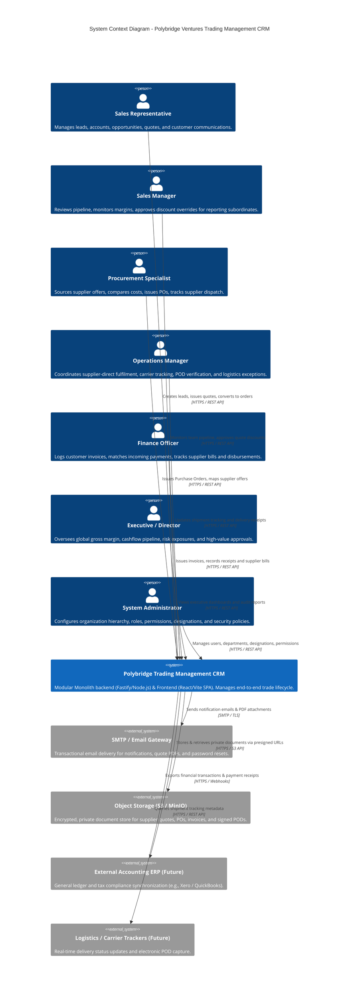
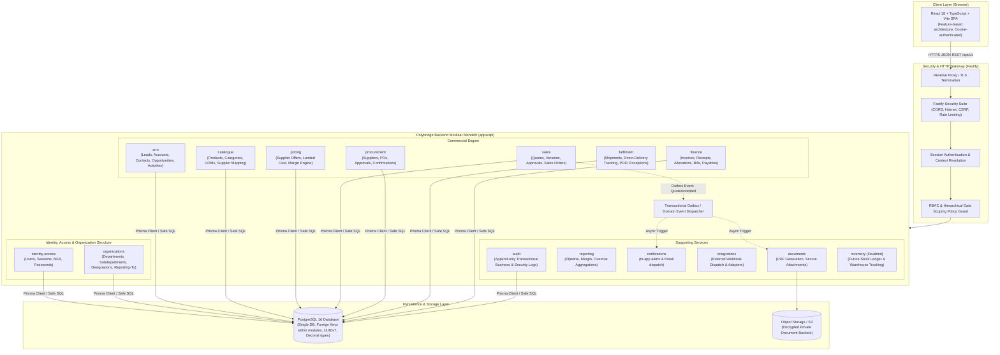

# System Context and Module Boundaries

## Status: Approved Architecture Specification (Phase 0)

Last Updated: 2026-10-14

---

## 1. Executive Architecture Summary

The Polybridge Ventures Trading Management CRM is engineered as a **Domain-Driven Design (DDD) Modular Monolith** implemented with Node.js, Fastify, TypeScript, Prisma, and PostgreSQL on the backend, paired with a React TypeScript SPA on the frontend, managed inside a single pnpm monorepo.

The system serves the operational needs of an international trading enterprise where products are sourced from global suppliers and delivered to business clients, utilizing both supplier-direct (drop-shipping) and future warehouse fulfilment models.

---

## 2. C4 Level 1: System Context Diagram

The following diagram illustrates the Polybridge Ventures system boundary, human user personas, and external system integrations.



---

## 3. C4 Level 2: Modular Monolith Architecture

The backend operates as a single executable runtime (Fastify HTTP server) internally partitioned into strictly isolated bounded contexts. Cross-module communication is restricted to public Application Service interfaces and asynchronous Outbox Events.



---

## 4. Bounded Contexts and Module Specifications

Every backend module adheres to a Domain-Driven Design layered architecture:

```
apps/api/src/modules/<module-name>/
├── domain/            # Entities, Value Objects, Domain Policies, Invariants, Domain Errors
├── application/       # Use Cases, Command Handlers, Query Handlers, DTOs, Service Interfaces
├── infrastructure/    # Prisma Repositories, Database Mappings, External Adapters
└── presentation/      # Fastify Route Handlers, JSON Schemas, Request/Response Serializers
```

### 4.1 Module Manifest & Responsibilities

| #   | Module            | Scope & Responsibility                                                                                                                                                             | Invariants & Business Rules                                                                                                                             |
| :-- | :---------------- | :--------------------------------------------------------------------------------------------------------------------------------------------------------------------------------- | :------------------------------------------------------------------------------------------------------------------------------------------------------ |
| 1   | `identity-access` | Authentication, password management (Argon2id), session management, logout, password reset tokens, MFA.                                                                            | Generic auth error messages; max 5 failed attempts per IP/account before rate limiting; no token leakage in logs.                                       |
| 2   | `organizations`   | Multi-level hierarchy: Departments, Subdepartments, Designations, User profiles, `reporting_to` line, Roles, Permissions, and Data Scopes (`can_read`, `can_write`, `data_scope`). | Deny-by-default; `reporting_to` acyclic hierarchy; user can only have active designation and department; data scopes enforce record boundary.           |
| 3   | `crm`             | Leads, customer Accounts, Contacts, Opportunities, and Activity tracking (calls, meetings, notes).                                                                                 | Lead conversion preserves original lead record; opportunities must link to an Account; duplicate email/tax ID detection.                                |
| 4   | `catalogue`       | Product master data, Categories, Units of Measure (UOM), and Supplier-to-Product cross-references.                                                                                 | Product SKU unique per organization; cannot delete product referenced in active quotes or orders; UOM conversion validation.                            |
| 5   | `pricing`         | Supplier offers, quoted costs, validity time windows, landing cost components, gross margin computation.                                                                           | Precise decimal math (no floating point); server computes margin; alert when gross margin falls below threshold.                                        |
| 6   | `sales`           | Quotation lifecycle, quote versioning, commercial approval queue, atomic Quote-to-Sales Order conversion.                                                                          | Final states (`ACCEPTED`, `EXPIRED`, `CANCELLED`) cannot be silently modified; Quote-to-Order conversion is transactional and idempotent.               |
| 7   | `procurement`     | Supplier directory, supplier contacts, Purchase Orders, PO approval, and supplier confirmation tracking.                                                                           | PO cannot be issued without authorization; PO line items reference valid supplier products; no automatic financial commitment without PO approval.      |
| 8   | `fulfilment`      | Supplier-direct delivery tracking, shipment references, carrier dispatch dates, expected arrival, Proof-of-Delivery (POD) metadata, exception logging.                             | Supplier-direct delivery does **not** create company warehouse stock movements; POD required for delivery completion.                                   |
| 9   | `finance`         | Customer Invoices, Payment Receipts, Allocations, Supplier Bills, and Supplier Payment disbursements.                                                                              | Financial records are immutable; no hard deletes (amendments/voids only); total allocations cannot exceed receipt amount; sequential invoice numbering. |
| 10  | `documents`       | Secure document attachment metadata, presigned URL generation, quote/invoice PDF compilation.                                                                                      | Allowlisted MIME types and extensions; documents are private by default; download requires object-level authorization; safe PDF template rendering.     |
| 11  | `reporting`       | Authorized analytical aggregations: pipeline value, win rate, gross margins, outstanding AR/AP balances.                                                                           | Scoped by user data scope; aggregate queries bounded by date filters; spreadsheet formula escaping on CSV exports (`=`, `+`, `-`, `@`).                 |
| 12  | `notifications`   | In-app notification feed and transactional email triggers.                                                                                                                         | Asynchronous delivery via background outbox; templates sanitized against HTML injection.                                                                |
| 13  | `integrations`    | Outbound webhooks and future carrier / accounting adapter interfaces.                                                                                                              | Destination allowlists; cryptographic signature on webhooks (`HMAC-SHA256`); timeout and dead-letter handling.                                          |
| 14  | `audit`           | Centralized append-only audit log for business transactions and security events.                                                                                                   | Synchronous in-transaction recording for critical events; actor, target, action, timestamp, diff recorded; redaction of secrets/PII.                    |
| 15  | `inventory`       | **Future Module (Disabled)**: Warehouses, bins, stock ledger, stock adjustments, counts.                                                                                           | Double-entry movement ledger; disabled by default; isolated so supplier-direct workflows remain uncompromised.                                          |

---

## 5. Architectural Invariants and Module Boundary Rules

### Rule 1: Layered Dependency Direction

- Dependencies must strictly flow inward: **Presentation $\rightarrow$ Application $\rightarrow$ Domain**.
- **Infrastructure** implements ports defined in the **Application** or **Domain** layer (Dependency Inversion Principle).
- Domain entities must have zero dependencies on Fastify, Prisma, or external network libraries.

### Rule 2: Strict Module Encapsulation

- No module may import from `apps/api/src/modules/<other-module>/domain`, `.../infrastructure`, or `.../presentation`.
- If Module A needs services from Module B, it must interact exclusively via Module B's public application port:
  `import { ISalesOrderQueryService } from '../sales/application/ports';`
- Cross-module transactions must be coordinated via application use cases or asynchronous domain events.

### Rule 3: Database Decoupling & Foreign Keys

- While tables reside in the same PostgreSQL database for transaction atomicity, foreign keys between distinct modules must be evaluated carefully:
  - Inside a bounded context (e.g., `Quote` $\rightarrow$ `QuoteLine`), enforce hard database foreign key constraints with `ON DELETE CASCADE` or `RESTRICT`.
  - Across bounded contexts (e.g., `SalesOrderLine` referencing `ProductId`), use foreign keys with `ON DELETE RESTRICT` to prevent orphan records, but never perform deep multi-table joins across 4+ module domains in a single raw query. Use application service composition.

### Rule 4: Standard User Role & Data Scoping Architecture

Every business query executed by any module must apply the **Data Scoping Policy**:

- **`OWN_ONLY`**: Restricts visible records to `created_by_id == currentUser.id` or `assigned_to_id == currentUser.id`.
- **`TEAM_AND_SUBORDINATES`**: Restricts records to the user and any member whose `reporting_to` line traces back to the user.
- **`SUBDEPARTMENT`**: Restricts records to users in the same `subdepartment_id`.
- **`DEPARTMENT`**: Restricts records to users in the same `department_id`.
- **`GLOBAL`**: Unrestricted access across the organization (reserved for executive, finance, and administrative roles).

---

## 6. Communication Flows & Transaction Patterns

### 6.1 Synchronous In-Process Invocations

When an operation requires immediate consistency within the same HTTP request (e.g., Quote conversion validating customer credit status or inventory flag):

- The `SalesOrderCreationUseCase` calls the `ICustomerAccountQueryService` and `IProductValidationService`.
- All operations execute inside an explicit `prisma.$transaction` block. If any check fails, the entire transaction rolls back cleanly.

### 6.2 Asynchronous Transactional Outbox Pattern

When a state transition triggers non-critical side effects (e.g., email notification, PDF generation, webhook notification):

- The domain event is inserted into the `outbox_events` table **inside the same database transaction** as the business entity change.
- A background worker reads unprocessed outbox events, dispatches them to the `notifications` or `integrations` module, and marks them processed.
- This guarantees **at-least-once delivery** and prevents ghost events if the database transaction were to fail.
