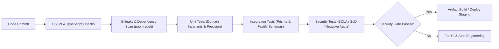

# Security Control Verification Checklist

## Baseline: OWASP ASVS 5.0 (Level 2), OWASP API Security Top 10 (2023), NIST CSF 2.0

## Status: Phase 0 Baseline Definition

Last Updated: 2026-10-14

---

> [!CAUTION]
> **Regulatory and Compliance Disclaimer:**
> The existence and execution of this security verification checklist does **not** constitute legal compliance, regulatory certification, or formal accreditation under SOC 2, ISO/IEC 27001, PCI-DSS, HIPAA, GDPR, or NIST standards. Security is an ongoing operational commitment. Verification status must be substantiated by automated tests, continuous integration logs, and periodic third-party penetration assessments.

---

## 1. Assurance Target & Scope

- **Target Assurance Level:** OWASP Application Security Verification Standard (ASVS) 5.0 **Level 2** (Applications handling sensitive commercial data, transactions, and business-critical operations).
- **Primary Attack Surface:** Fastify REST API (`/api/v1`), React Single Page Application, PostgreSQL database storage, private document storage, and outbound integrations.
- **Verification Rule:** A security control is marked `VERIFIED` only after automated test suites (unit, integration, or negative authorization tests) execute successfully in CI and produce traceable test reports.

---

## 2. Comprehensive Security Control Checklist

### 2.1 ASVS V1: Architecture, Design and Threat Modeling

| Control ID     | Framework Ref             | Security Requirement                                                                             | Verification Method           | Target Phase | Status                          |
| :------------- | :------------------------ | :----------------------------------------------------------------------------------------------- | :---------------------------- | :----------- | :------------------------------ |
| **SEC-ARC-01** | ASVS 1.1.1 NIST PR.AT | Threat model documented covering all components, trust boundaries, and commercial data flows.    | Architecture Review           | Phase 0      | **VERIFIED (Phase 0 Artifact)** |
| **SEC-ARC-02** | ASVS 1.1.2 NIST PR.DS | Bounded contexts enforce domain separation; no unauthorized database or module boundary bypass.  | Static Linting / Module Rules | Phase 1      | Planned                         |
| **SEC-ARC-03** | ASVS 1.4.1 API9:2023  | Versioned API under `/api/v1` with documented OpenAPI schemas and deprecated route retirement.   | API Contract Tests            | Phase 1      | Planned                         |
| **SEC-ARC-04** | ASVS 1.14.1 API6:2023 | Explicit business state machines enforce sequence and preconditions for quotes, orders, and POs. | Domain Unit Tests             | Phase 4      | Planned                         |

---

### 2.2 ASVS V2: Authentication Verification

| Control ID     | Framework Ref             | Security Requirement                                                                                       | Verification Method       | Target Phase | Status  |
| :------------- | :------------------------ | :--------------------------------------------------------------------------------------------------------- | :------------------------ | :----------- | :------ |
| **SEC-AUT-01** | ASVS 2.1.1 API2:2023  | Passwords hashed using Argon2id with memory cost $\ge 64$MB, 3 iterations, 1 parallelism thread.           | Cryptographic Unit Test   | Phase 2      | Planned |
| **SEC-AUT-02** | ASVS 2.1.7 NIST PR.AC | Minimum password length $\ge 12$ characters with character diversity checks and common password blocklist. | Unit Validation Tests     | Phase 2      | Planned |
| **SEC-AUT-03** | ASVS 2.2.1 API2:2023  | Generic authentication error messages ("Invalid email or password") preventing username enumeration.       | API Integration Test      | Phase 2      | Planned |
| **SEC-AUT-04** | ASVS 2.2.2 API4:2023  | Rate limiting on login and password reset routes: max 5 failures per IP/email per 15 minutes.              | Automated Rate Limit Test | Phase 2      | Planned |
| **SEC-AUT-05** | ASVS 2.8.1 NIST PR.AC | Multi-Factor Authentication (MFA/TOTP) supported and enforceable for administrative & finance roles.       | Integration Test Suite    | Phase 2      | Planned |
| **SEC-AUT-06** | ASVS 2.5.1 API2:2023  | Password reset uses cryptographically secure random tokens with max 15-minute validity, single-use.        | Token Lifecycle Test      | Phase 2      | Planned |

---

### 2.3 ASVS V3: Session Management

| Control ID     | Framework Ref             | Security Requirement                                                                                         | Verification Method         | Target Phase | Status  |
| :------------- | :------------------------ | :----------------------------------------------------------------------------------------------------------- | :-------------------------- | :----------- | :------ |
| **SEC-SES-01** | ASVS 3.2.1 API2:2023  | Session tokens stored exclusively in `HttpOnly`, `Secure`, `SameSite=Lax` cookies; no token in localStorage. | Browser/API Contract Test   | Phase 2      | Planned |
| **SEC-SES-02** | ASVS 3.3.1 NIST PR.AC | Session tokens use 256-bit cryptographically secure entropy, stored hashed (SHA-256) in PostgreSQL.          | Crypto Unit Test            | Phase 2      | Planned |
| **SEC-SES-03** | ASVS 3.4.1 NIST PR.AC | Absolute session timeout (8 hours) and idle timeout (60 minutes) enforced server-side.                       | Expiration Integration Test | Phase 2      | Planned |
| **SEC-SES-04** | ASVS 3.5.1 NIST PR.AC | Explicit logout immediately revokes session token in database; password change invalidates all sessions.     | Revocation Test             | Phase 2      | Planned |

---

### 2.4 ASVS V4: Access Control & Authorization (BOLA / Hierarchical Scoping)

| Control ID     | Framework Ref             | Security Requirement                                                                                         | Verification Method      | Target Phase | Status  |
| :------------- | :------------------------ | :----------------------------------------------------------------------------------------------------------- | :----------------------- | :----------- | :------ |
| **SEC-ACC-01** | ASVS 4.1.1 API5:2023  | Deny-by-default RBAC enforced at Fastify route layer on all protected endpoints.                             | Negative Authz Tests     | Phase 2      | Planned |
| **SEC-ACC-02** | ASVS 4.1.2 API1:2023  | Object-Level Authorization (BOLA/IDOR prevention): every record fetch validates user scope & ownership.      | Negative IDOR Tests      | Phase 2      | Planned |
| **SEC-ACC-03** | ASVS 4.1.3 NIST PR.AC | Hierarchical data scoping (`OWN_ONLY`, `TEAM_AND_SUBORDINATES`, `DEPARTMENT`, `GLOBAL`) enforced in queries. | Scope Filter Tests       | Phase 2      | Planned |
| **SEC-ACC-04** | ASVS 4.1.4 NIST PR.AC | Separation of Duties (SoD): Users cannot approve their own high-value Quotes or Purchase Orders.             | Business Rule Unit Tests | Phase 4      | Planned |
| **SEC-ACC-05** | ASVS 4.2.1 API3:2023  | Broken Object Property Auth (BOPA) prevention: client cannot set approval flags, margins, or role IDs.       | Mass Assignment Tests    | Phase 2      | Planned |

---

### 2.5 ASVS V5: Validation, Sanitization and Encoding

| Control ID     | Framework Ref             | Security Requirement                                                                                     | Verification Method     | Target Phase | Status  |
| :------------- | :------------------------ | :------------------------------------------------------------------------------------------------------- | :---------------------- | :----------- | :------ |
| **SEC-VAL-01** | ASVS 5.1.1 API3:2023  | Fastify JSON Schema validation on every request body, query, and parameter; reject unknown properties.   | Schema Validation Tests | Phase 1      | Planned |
| **SEC-VAL-02** | ASVS 5.1.2 NIST PR.DS | Strict bounds on all strings, array lengths, pagination parameters (`limit <= 100`), and numeric ranges. | Boundary Tests          | Phase 1      | Planned |
| **SEC-VAL-03** | ASVS 5.2.1 NIST PR.DS | Database parameterized queries via Prisma; raw SQL strictly forbidden or reviewed with safe bindings.    | Static Code Analysis    | Phase 1      | Planned |
| **SEC-VAL-04** | ASVS 5.3.1 API6:2023  | CSV Formula Injection sanitization: prefixes (`=`, `+`, `-`, `@`) escaped with single quote on export.   | Export Serializer Tests | Phase 6      | Planned |
| **SEC-VAL-05** | ASVS 5.4.1 NIST PR.DS | Monetary arithmetic executed with Decimal.js and PostgreSQL `NUMERIC`; no JavaScript float operations.   | Precision Unit Tests    | Phase 1      | Planned |

---

### 2.6 ASVS V7: Error Handling, Logging and Auditing

| Control ID     | Framework Ref             | Security Requirement                                                                                          | Verification Method     | Target Phase | Status  |
| :------------- | :------------------------ | :------------------------------------------------------------------------------------------------------------ | :---------------------- | :----------- | :------ |
| **SEC-LOG-01** | ASVS 7.1.1 API8:2023  | Generic API error response envelope (`errorCode`, `message`, `correlationId`); no stack traces exposed.       | Error Handling Tests    | Phase 1      | Planned |
| **SEC-LOG-02** | ASVS 7.2.1 NIST DE.CM | Structured logging (Pino) with automatic redaction of passwords, tokens, cookies, and sensitive PII.          | Log Redaction Tests     | Phase 1      | Planned |
| **SEC-LOG-03** | ASVS 7.3.1 NIST PR.PT | Business and security events logged synchronously in the same database transaction as the entity change.      | Audit Integration Tests | Phase 2      | Planned |
| **SEC-LOG-04** | ASVS 7.3.2 NIST PR.DS | Audit log table permissions restricted to `INSERT` and `SELECT`; `UPDATE` and `DELETE` revoked from app role. | DB Role Permission Test | Phase 1      | Planned |

---

### 2.7 ASVS V8 & V13: Data Protection & API Integrations

| Control ID     | Framework Ref              | Security Requirement                                                                                             | Verification Method       | Target Phase | Status  |
| :------------- | :------------------------- | :--------------------------------------------------------------------------------------------------------------- | :------------------------ | :----------- | :------ |
| **SEC-DAT-01** | ASVS 8.1.1 NIST PR.DS  | TLS 1.3 enforced in production for all client-to-server and server-to-database communications.                   | Infrastructure Tests      | Phase 7      | Planned |
| **SEC-DAT-02** | ASVS 8.3.1 NIST PR.DS  | Sensitive configuration secrets (DB URL, session secrets) supplied via environment variables; none in Git.       | Gitleaks / Secret Scanner | Phase 1      | Planned |
| **SEC-INT-01** | ASVS 13.1.1 API7:2023  | Outbound SSRF guard: DNS resolution check blocking loopback, private RFC 1918, and metadata IPs.                 | Network Adapter Tests     | Phase 1      | Planned |
| **SEC-INT-02** | ASVS 13.2.1 API10:2023 | Outbound webhook delivery requires destination domain allowlisting and HMAC-SHA256 signature header.             | Integration Webhook Tests | Phase 6      | Planned |
| **SEC-INT-03** | ASVS 13.3.1 API4:2023  | Concurrency protection: Idempotency keys and DB pessimistic locks (`FOR UPDATE`) on quote conversion & payments. | Concurrency Stress Tests  | Phase 4      | Planned |

---

### 2.8 ASVS V14: Configuration and File Uploads

| Control ID     | Framework Ref              | Security Requirement                                                                                         | Verification Method    | Target Phase | Status  |
| :------------- | :------------------------- | :----------------------------------------------------------------------------------------------------------- | :--------------------- | :----------- | :------ |
| **SEC-CFG-01** | ASVS 14.1.1 API8:2023  | Security headers configured via `@fastify/helmet`: CSP, X-Frame-Options: DENY, HSTS, X-Content-Type-Options. | HTTP Header Tests      | Phase 1      | Planned |
| **SEC-CFG-02** | ASVS 14.2.1 API8:2023  | CORS policy restricted to explicit frontend origin; no wildcard (`*`) allowed with credentials enabled.      | CORS Integration Tests | Phase 1      | Planned |
| **SEC-UPL-01** | ASVS 14.4.1 API8:2023  | Uploaded documents checked for extension and magic bytes; executables and SVGs blocked.                      | Negative Upload Tests  | Phase 6      | Planned |
| **SEC-UPL-02** | ASVS 14.4.2 NIST PR.DS | Document attachments stored in private S3 bucket; downloaded via short-lived authorized presigned URLs.      | Presigned URL Tests    | Phase 6      | Planned |

---

## 3. Continuous Verification Workflow

## 4. Verification Evidence Register

As phases progress from Phase 0 to Phase 7, automated test runs will publish reports to:

- Test Results: `reports/tests/security-verification-report.json`
- Dependency Scans: `reports/security/dependency-audit.json`
- Static Analysis: `reports/security/semgrep-results.json`
